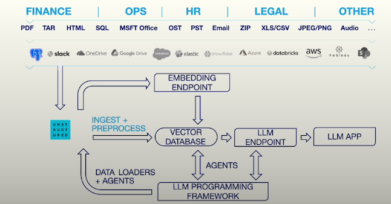

# Preprocessing Unstructured Data for LLM Applications

### Overview of LLM Data Processing

**RAG** A technique for grounding LLM responses on validated external information.  
**Contextual Integration** RAG apps load context into a database, then retrieve content to insert into a prompt.  

